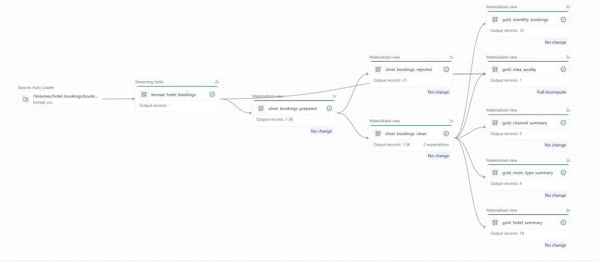
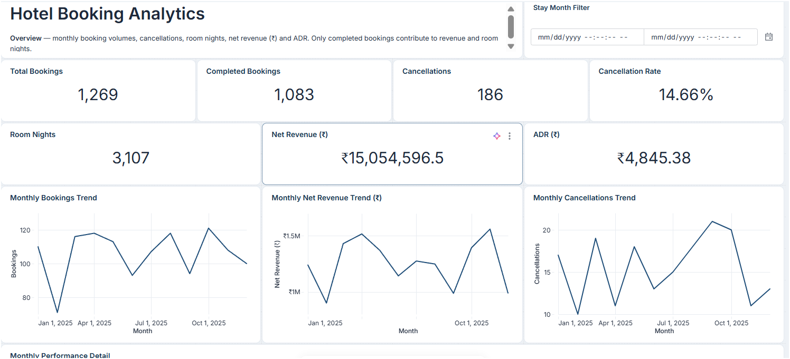
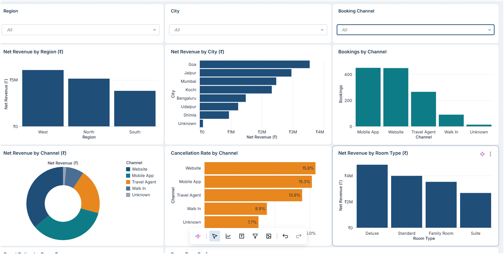
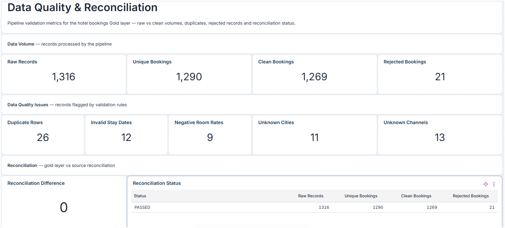
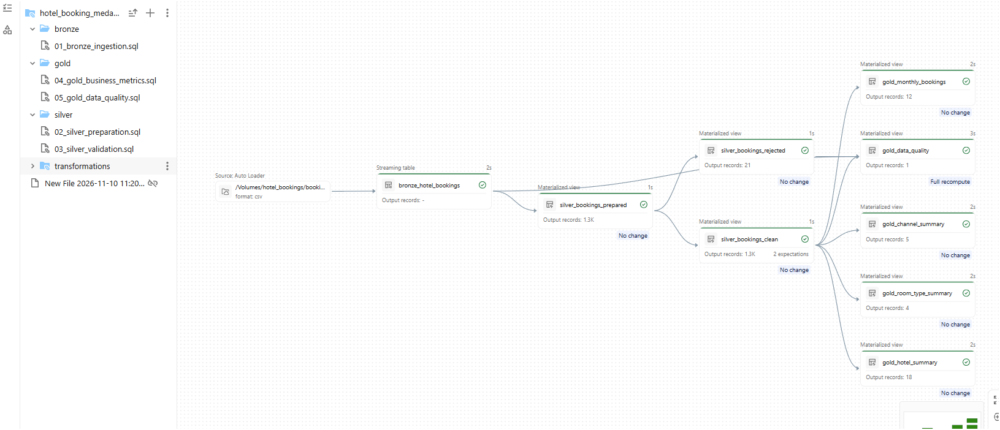

# Hotel Booking Analytics | Databricks Medallion Architecture

**End-to-End Data Engineering & Business Analytics Project**

A Databricks-based data engineering solution that transforms raw hotel booking data into clean, validated, business-ready datasets using **Medallion Architecture (Bronze, Silver, Gold)**, Lakeflow Spark Declarative Pipelines, SQL and Databricks AI/BI Dashboards.

## Project Overview

This project implements an end-to-end hotel booking data pipeline to analyze booking trends, cancellations, revenue, hotel performance, room types and booking channels.

The solution ingests raw CSV data, performs deduplication and data-quality validation, creates analytical Gold datasets, and delivers an interactive three-page dashboard.

## Technology Stack

- **Platform:** Databricks
- **Data Storage:** Unity Catalog Volumes
- **Data Governance:** Unity Catalog
- **Data Processing:** Databricks SQL
- **Pipeline Orchestration:** Lakeflow Spark Declarative Pipelines
- **Architecture:** Bronze, Silver and Gold Medallion Architecture
- **Data Ingestion:** Streaming Tables and `STREAM read_files()`
- **Transformations:** SQL Materialized Views
- **Visualization:** Databricks AI/BI Dashboards

## Data Architecture

### Bronze — Raw Ingestion

- Ingested 1,316 raw hotel booking records from CSV files.
- Used a streaming table for incremental file ingestion.
- Captured source-file metadata and ingestion timestamps.

### Silver — Cleaning & Validation

- Removed 26 duplicate booking records.
- Prepared 1,290 unique bookings.
- Retained 1,269 valid bookings.
- Separated 21 invalid records into a rejected dataset.
- Applied validation rules for stay dates and room rates.

### Gold — Business Analytics

Created five materialized views:

1. `gold_monthly_bookings`
2. `gold_hotel_summary`
3. `gold_room_type_summary`
4. `gold_channel_summary`
5. `gold_data_quality`

These datasets support business reporting and data-quality monitoring.

## Key Business Results

| KPI | Result |
|---|---:|
| Total Valid Bookings | 1,269 |
| Completed Bookings | 1,083 |
| Cancelled Bookings | 186 |
| Cancellation Rate | 14.66% |
| Completed Room Nights | 3,107 |
| Net Revenue | ₹15,054,596.50 |
| Average Daily Rate (ADR) | ₹4,845.38 |

Revenue and room-night calculations include completed bookings only.

## Data Quality & Reconciliation

| Quality Metric | Result |
|---|---:|
| Raw Records | 1,316 |
| Duplicate Records | 26 |
| Unique Bookings | 1,290 |
| Valid Bookings | 1,269 |
| Rejected Bookings | 21 |
| Invalid Stay Dates | 12 |
| Negative Room Rates | 9 |
| Unknown Cities | 11 |
| Unknown Booking Channels | 13 |
| Reconciliation Difference | 0 |
| Reconciliation Status | PASSED |

**Reconciliation:** 1,316 = 1,269 + 21 + 26

## Interactive Dashboard

Developed a three-page Databricks AI/BI Dashboard.

### Page 1 — Booking Overview

Displays booking KPIs, revenue, ADR, cancellation rates and monthly trends.

### Page 2 — Hotels, Rooms & Channels

Analyzes hotel performance, region and city comparisons, room types, booking channels and guest ratings.

### Page 3 — Data Quality & Reconciliation

Monitors data-quality issues, rejected records, duplicate records and reconciliation results.

## SQL Implementation

The SQL scripts are organized by Medallion Architecture layer.

| Layer | SQL File | Purpose |
|---|---|---|
| Bronze | [01_bronze_ingestion.sql](sql/bronze/01_bronze_ingestion.sql) | Raw CSV ingestion |
| Silver | [02_silver_preparation.sql](sql/silver/02_silver_preparation.sql) | Deduplication and cleaning |
| Silver | [03_silver_validation.sql](sql/silver/03_silver_validation.sql) | Clean and rejected record separation |
| Gold | [04_gold_business_metrics.sql](sql/gold/04_gold_business_metrics.sql) | Business-level aggregations |
| Gold | [05_gold_data_quality.sql](sql/gold/05_gold_data_quality.sql) | Quality checks and reconciliation |

## Pipeline Execution

The pipeline was developed using Databricks Lakeflow Spark Declarative Pipelines.

**Pipeline:** `hotel_booking_medallion_pipeline`

**Catalog:** `hotel_bookings`

**Schema:** `bookings`

All nine pipeline datasets were successfully executed and validated.

## Key Learnings

- Implementing Medallion Architecture in Databricks.
- Working with Unity Catalog, schemas and Volumes.
- Building SQL-based streaming tables and materialized views.
- Designing reusable data cleaning and validation logic.
- Separating rejected records for data-quality investigation.
- Implementing record-count reconciliation.
- Developing Gold-layer business metrics.
- Building and testing Databricks AI/BI Dashboards.
- Understanding dashboard filtering limitations across aggregated datasets.

## Detailed Documentation

For the complete technical implementation, architecture, transformation rules, validation logic and dashboard testing, see:

[Architecture & Workflow Documentation](docs/architecture_and_workflow.md)

## Project Outcome

Successfully developed an end-to-end Databricks data pipeline that processes raw hotel booking records, applies quality checks, creates business-ready analytical datasets and supports interactive reporting.

The solution achieved a **zero record-count reconciliation difference** and provides a structured foundation for hotel booking analytics.
